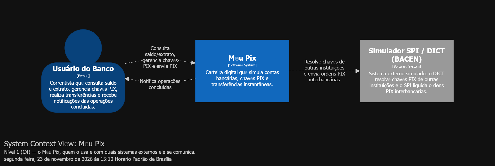
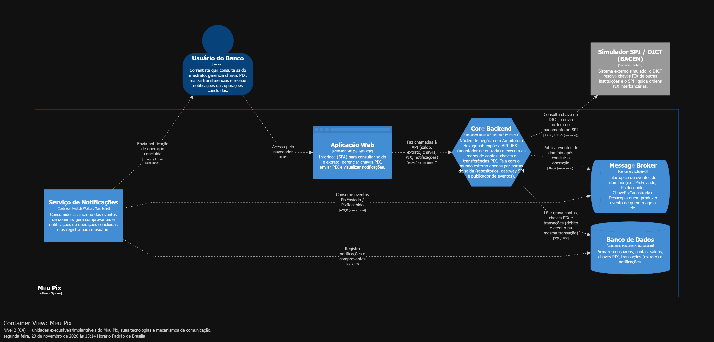

# Diagramas C4 — Meu Pix

A **fonte oficial** dos diagramas é o arquivo [`workspace.dsl`](../../workspace.dsl) (Structurizr DSL).
Os diagramas abaixo são uma **cópia em Mermaid** das mesmas visões, só para que possam ser lidos diretamente no GitHub.
Ao alterar a arquitetura, altere primeiro o `workspace.dsl` e depois replique aqui.

Como visualizar o DSL (Structurizr Lite), a partir da raiz do repositório:

```bash
docker run -it --rm -p 8080:8080 -v "$PWD":/usr/local/structurizr structurizr/lite
```

Depois é só abrir http://localhost:8080. Também dá para colar o conteúdo do `workspace.dsl` em https://structurizr.com/dsl.

---

## Nível 1 — Diagrama de Contexto

**Pergunta que responde:** *o que é o sistema, quem o usa e com quem ele conversa?*



| Elemento | Tipo | Responsabilidade |
|---|---|---|
| Usuário do Banco | Pessoa | Correntista: consulta saldo/extrato, cadastra/remove chaves PIX, envia PIX e recebe notificações. |
| Meu Pix | Sistema (em foco) | Mantém contas, saldos, chaves PIX e transações e aplica as regras de negócio do PIX. |
| Simulador SPI / DICT (BACEN) | Sistema externo | Simula o diretório de chaves (DICT) e o sistema de liquidação (SPI) do Banco Central, usado quando a chave de destino é de outra instituição. |

---

## Nível 2 — Diagrama de Containers

**Pergunta que responde:** *quais são as partes executáveis do sistema, que tecnologia cada uma usa e como elas se comunicam?*



### Containers e responsabilidades

| Container | Tecnologia | Responsabilidade |
|---|---|---|
| Aplicação Web | Vue.js / TypeScript | Interface do usuário. Não tem regra de negócio: só chama a API REST. |
| Core Backend | Node.js / Express / TypeScript | **Hexágono** do sistema. Os controladores REST são *adaptadores de entrada*; o domínio (Conta, ChavePix, Transação) e os casos de uso ficam no centro; banco, SPI e broker são acessados por *portas de saída* implementadas por adaptadores. |
| Message Broker | RabbitMQ | Recebe os eventos de domínio publicados pelo Core e os entrega aos consumidores, de forma assíncrona. |
| Serviço de Notificações | Node.js Worker / TypeScript | Reage aos eventos `PixEnviado`/`PixRecebido`, gera o comprovante e notifica pagador e recebedor. |
| Banco de Dados | PostgreSQL (Supabase) | Persistência de contas, saldos, chaves PIX, transações e notificações. |

### Mecanismos de comunicação e fluxo de dados

| Origem → Destino | Mecanismo | Síncrono? | Por quê |
|---|---|---|---|
| Aplicação Web → Core Backend | REST, JSON sobre HTTPS | Sim | O usuário precisa da resposta na hora (saldo, comprovante). |
| Core Backend → Banco de Dados | SQL/TCP | Sim | O débito na origem e o crédito no destino precisam ser **atômicos** (mesma transação). |
| Core Backend → Simulador SPI/DICT | REST, JSON sobre HTTPS | Sim | Só conseguimos confirmar um PIX para outra instituição depois que o SPI liquida a ordem. |
| Core Backend → Message Broker | AMQP (publish) | **Não** | Notificar é consequência da transferência, não parte dela: se o envio da notificação falhar, o PIX não pode ser desfeito. |
| Serviço de Notificações → Message Broker | AMQP (consume) | **Não** | Permite adicionar outros consumidores (antifraude, auditoria) sem mexer no Core. |

**Fluxo principal — Enviar PIX (visão de containers):**

1. O usuário informa a chave de destino e o valor na **Aplicação Web**.
2. A Aplicação Web envia `POST /contas/{id}/pix` ao **Core Backend**.
3. O Core valida o valor e o saldo, e resolve a chave. Se a chave for do Meu Pix, busca no **Banco de Dados**; se não for, consulta o DICT no **Simulador SPI**.
4. O Core debita a origem e credita o destino na mesma transação (ou envia a ordem ao SPI, se o destino for externo) e grava a transação no extrato.
5. O Core devolve o comprovante ao usuário **e** publica `PixEnviado`/`PixRecebido` no **Message Broker**.
6. O **Serviço de Notificações** consome os eventos, registra as notificações no banco e avisa pagador e recebedor.

> Os diagramas de **Componentes** (nível 3) e **Código** (nível 4) ficam para a entrega de 23/11–24/11.
