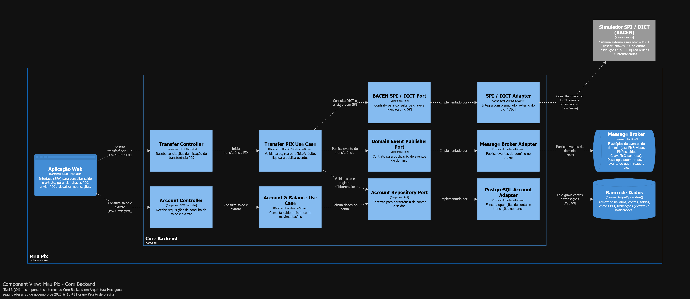
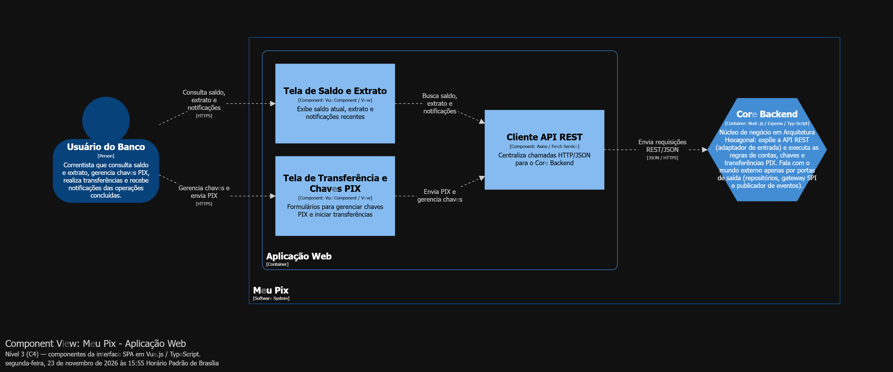
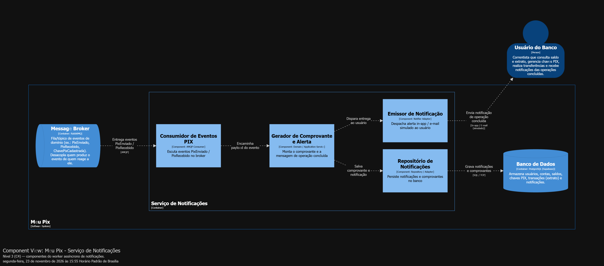

# Meu Pix - Sistema Bancário e PIX

Repositório oficial do projeto final da disciplina de **Arquitetura de Software**, desenvolvido com foco no domínio de **Sistema Bancário e PIX**.

## Sobre o Projeto

O **Meu Pix** é uma carteira digital que simula contas bancárias, gerenciamento de chaves PIX e transferências instantâneas. O sistema foi projetado para permitir que correntistas consultem saldo e extrato, cadastrem e gerenciem chaves PIX, realizem transferências instantâneas de forma segura e recebam notificações assíncronas das operações concluídas.

## Estilo Arquitetural: Arquitetura Hexagonal (Ports and Adapters)

O núcleo da aplicação (**Core Backend**) adota **majoritariamente os princípios da Arquitetura Hexagonal**, complementado por comunicação orientada a eventos para notificações assíncronas.

* **Por que essa escolha?** O domínio de negócio (regras de contas, chaves PIX, validação de saldo e liquidação de transferências) fica completamente isolado de detalhes tecnológicos externos (como frameworks web, bancos de dados, filas de mensageria ou o simulador do SPI/DICT do BACEN).
* **Vantagens:** Facilidade para testar regras de negócio de forma isolada, baixo acoplamento e flexibilidade para substituir adaptadores de entrada (REST APIs) e de saída (PostgreSQL, RabbitMQ, Gateway SPI/DICT) sem impactar o núcleo da aplicação.

## Funcionalidades Desenvolvidas

O escopo funcional documentado e implementado parcialmente compreende:

1. **Gerenciamento de Contas e Saldo:**
   * Consulta de saldo em tempo real e visualização do extrato de movimentações.
2. **Gerenciamento de Chaves PIX:**
   * Cadastro, listagem e exclusão de chaves PIX vinculadas à conta (CPF, E-mail, Telefone, Chave Aleatória).
3. **Realização de Transferência PIX:**
   * Consulta e resolução de chave de destino (incluindo integração simulada com DICT/SPI).
   * Validação de saldo suficiente e efetivação transacional (débito na origem e crédito no destino).
4. **Notificações de Operações:**
   * Publicação de eventos de domínio (`PixEnviado`, `PixRecebido`) e processamento assíncrono para geração de comprovantes e envio de notificações ao usuário.

## Modelagem Arquitetural (C4 Model & Structurizr)

A documentação arquitetural do sistema segue o **Modelo C4** definido como código no arquivo `workspace.dsl` (Structurizr DSL), contemplando os níveis de Contexto, Containers e Componentes.

### Nível 1 — Diagrama de Contexto
Apresenta o **Meu Pix**, sua interação com o **Usuário do Banco** e a comunicação externa com o **Simulador SPI / DICT (BACEN)**.


### Nível 2 — Diagrama de Containers
Detalha as unidades executáveis e armazenamentos do sistema: **Aplicação Web** (Vue.js / TypeScript), **Core Backend** (Node.js / Express / TypeScript em Arquitetura Hexagonal), **Message Broker** (RabbitMQ), **Serviço de Notificações** (Node.js Worker / TypeScript) e **Banco de Dados** (PostgreSQL / Supabase).


### Nível 3 — Diagramas de Componentes

#### Core Backend (Arquitetura Hexagonal)
Detalha a divisão interna entre **Adapters de Entrada** (Controllers REST), **Casos de Uso** (Application/Domain Services), **Portas** (Interfaces) e **Adapters de Saída** (PostgreSQL, SPI/DICT e Message Broker).



#### Aplicação Web (SPA)
Detalha as telas principais (**Tela de Saldo e Extrato**, **Tela de Transferência e Chaves PIX**) e o **Cliente API REST** responsável pela comunicação com o backend.



#### Serviço de Notificações (Worker)
Detalha o fluxo assíncrono composto pelo **Consumidor de Eventos PIX**, **Gerador de Comprovante e Alerta**, **Repositório de Notificações** e **Emissor de Notificação**.



## Estrutura do Repositório

```
├── workspace.dsl         # Definição completa dos diagramas C4 (Níveis 1, 2 e 3)
├── README.md             # Documentação principal do projeto
├── docs/                 # Decisões arquiteturais e imagens exportadas dos diagramas
└── src/                  # Código-fonte da aplicação (Implementação Parcial)
```

## Equipe e Divisão de Atividades

* As decisões arquiteturais detalhadas estão documentadas em `docs/DECISOES-ARQUITETURAIS.md`.
* A divisão de tarefas e o acompanhamento do desenvolvimento são gerenciados através das *Issues* e *Projects* deste repositório no GitHub.
